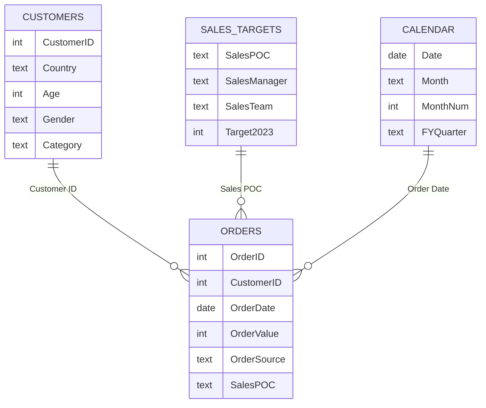

# Orders Analytics Dashboard (Power BI Case Study)

An end-to-end Power BI project that turns raw **orders, customers and sales-target data** into an interactive, stakeholder-ready dashboard. It answers: *Which markets, managers, customers and channels drive orders and revenue, and where are we falling short of target?*

> **Tools:** Power BI Desktop, Power Query (M), DAX, Excel


## Business problem

The company wants to increase the number of orders, order value and revenue. As the analyst, the task was to import the data, clean it, build a data model and report on sales targets, manager performance, order patterns, customer behaviour and order channels.

## Dataset

Excel workbook with three tables:

| Table | Rows | Key columns |
|---|---|---|
| **Orders** | 2,500 | Order ID, Customer ID, Order Datetime, Order Value, Order Source, Sales POC, Customer Country |
| **Customers** | 2,500 | Customer ID, Customer Country, Age, Gender, Category |
| **Sales Targets** | 92 | Sales POC, Sales Manager First/Last Name, Sales Team, 2023 Sales Target |

Orders cover calendar year 2023, across 14 countries, 5 sales teams and 30 sales managers.

## Data preparation (Power Query)

- **Sales channel bug:** the Sales Channel (`Order Source`) was not captured for **8 orders on 1 April 2023** (first missing 00:49, last 23:57), the first day of the new financial year. Missing values were replaced with **"Not Captured"** rather than guessed. The column is categorical, the top three sources are nearly equal (639 / 635 / 626), so imputing the mode would add bias, and deleting rows would remove real sales. The gap is shown openly on the dashboard.
- **Sales Manager:** First and last names were merged into a full-name column (two managers share the first name Benjamin, so first name alone is ambiguous).
- Trimmed text columns, set data types, added `Order Date` and removed the duplicate `Customer Country` column from Orders (it matched Customers 100%).

## Data model

Star schema with `Orders` as the fact table.



A `Calendar` table (with financial-year quarters, April start) supports time analysis. All measures live in a dedicated `Measures` table. See [docs/DAX_measures.md](docs/DAX_measures.md).

## Report pages

| Page | What it answers |
|---|---|
| **Home** | Cover and navigation |
| **Sales Targets** | KPI of actual vs target, target status buckets, team targets, slicers for team, manager and POC |
| **Managers** | % of target reached by each manager, coloured by team |
| **Top Managers** | Top manager per country by sales value, orders and customers |
| **Orders Trend** | Monthly orders and sales, best and weakest month, financial quarters |
| **Country Map** | Orders and average order value by country, drill-through to managers |
| **Customers** | Customers who never ordered, Indian male customers, age and sales by category |
| **Order Sources** | Most used order channel by country |


## Key insights

- **Overall:** sales of **12,275,890** from **2,500 orders** (average order value about 4,910) against a target of **12.81M**, i.e. **95.8%** achievement.
- **Teams:** only **Alpha** beat its target (**104.7%**). **Delta** is furthest behind (**86.6%**).
- **POCs:** **55** of 92 Sales POCs missed target (average shortfall **21,703.53**), **37** exceeded it and **none** landed exactly on target.
- **Highest target:** a tie between **Noah Meier** and **Benjamin Chen** (1.3M each). Noah reached 107.9%, Benjamin 79.4%.
- **Top manager by country:** Noah Meier leads sales in **10 of 14** countries. Winners differ by metric (sales, orders, customers) in 5 countries: Finland, Switzerland, Norway, Germany and Austria.
- **Seasonality:** **November** is the best month (229 orders, 1.20M sales). September and December are the weakest.
- **Markets:** the **USA** gives 888 of 2,500 orders (about 36%). Austria has the highest average order value (5,207) but only 43 orders.
- **Customers:** **100% of Category E customers never placed an order**, versus 24 to 31% in Categories A to D.
- **Channels:** no channel dominates. App leads outright in 5 countries, Whatsapp in 3, Website in 2 and Other in 1, with 3 ties.

## Tasks covered

- [x] Import tables and handle missing Sales Channel values
- [x] Sales Manager column and data model
- [x] Sales target buckets, team targets, shortfall, % target reached
- [x] Top managers by country (sales, orders, customers)
- [x] Monthly order trend
- [x] Country map (orders and AOV)
- [x] Customers with no orders, customer category insights
- [x] Order source by country


## Design

Custom dark theme ([assets/theme/Orders_Dark_Theme.json](assets/theme/Orders_Dark_Theme.json)) and order-themed backgrounds (shipping routes across the 14 order countries) in [assets/backgrounds](assets/backgrounds).

## How to use

1. Install [Power BI Desktop](https://powerbi.microsoft.com/desktop/) (Windows).
2. Download `powerbi/Orders_Analytics_Dashboard.pbix` and open it.
3. If asked, point the data source to the Excel file in `/data` (Home > Transform data > Data source settings > Change source).

## Repository structure

```
orders-powerbi-case-study/
├── powerbi/            # PBIX report
├── data/               # source Excel workbook
├── assets/
│   ├── backgrounds/    # page backgrounds (PNG)
│   └── theme/          # Power BI theme (JSON)
├── docs/
│   ├── DAX_measures.md
│   └── screenshots/    # report screenshots
└── README.md
```

## Author

**ABHISHAK KHANDELWAL** | [LinkedIn](https://www.linkedin.com/in/abhishak-khandelwal/) 
